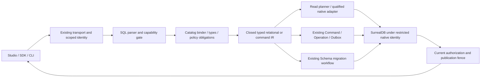

# 136 · Mensoria DB SQL language and execution design

[Documentation index](README.md) · [Authoritative requirements](../../specs/004-surrealdb-rust-ai-baas/spec.md#mensoria-db-sql-language-design-2026-10-29-documentation-only) · [Interface contract](../../specs/004-surrealdb-rust-ai-baas/contracts/mensoria-sql.md) · [Review and acceptance](../../specs/004-surrealdb-rust-ai-baas/mensoria-sql-design-review.md)

**Normative language:** [Mensoria SQL Standard Draft — Full Edition](137-mensoria-sql-standard-draft.md). This chapter owns architecture/delivery; the full draft owns syntax and observable language semantics.

**Status:** proposed design, 2026-10-29. No SQL endpoint, parser, migration, PostgreSQL protocol or driver support is enabled by this document. Mensoria DB remains the SurrealDB-based database service. Existing identifiers and native administration contracts are preserved.

## 1. Product decision

Offer **Mensoria SQL v1**: a standard-oriented SQL subset with selected PostgreSQL notation, a published capability matrix and explicit Mensoria safety restrictions. Make ordinary relational queries familiar while retaining document storage and the existing authorization/operation model. SQL is a language front end to the current Data and Schema application services, not a replacement database or a separate privileged proxy.

“Standard” means explicit, versioned and testable semantics here. It does not mean full ISO/IEC 9075 conformance, PostgreSQL equivalence or automatic ORM compatibility. A future conformance claim requires a named standard edition, feature inventory and actual conformance evidence. This design uses public PostgreSQL 18 documentation as a practical reference, not as a substitute for the ISO standard.

The user journeys are:

1. Discover enabled SQL capabilities for the selected environment and current identity.
2. Enter SQL and typed parameters; validate to obtain ordered result types, required capabilities and a frozen artifact.
3. Explicitly execute; inspect bounded results and a typed error or original operation reference.
4. For writes, supply an original idempotency key and expected revisions; reconcile an uncertain result before another attempt.
5. For DDL, review a Schema migration proposal and apply it through the existing maintenance workflow.

The SQL editor displays the scope, language profile, read/write class, parameter types, result completeness and operation outcome. It does not offer an execution action for unsupported or unqualified features. A generated query remains a draft until separately validated and explicitly executed. Native SurrealQL is a separately authorized administration surface; SQL text is never retried as native text when translation fails.

## 2. Compatibility profiles and staged scope

These are delivery profiles, not claims about the current installation. An environment publishes a profile only when all its requirements pass; optional features have their own flags. Disabled capabilities fail validation with `0A000 FEATURE_NOT_SUPPORTED`. SQL v1 features are intentionally narrower than the upstream parser.

| Capability | R1: relational reads | W1: bounded writes, requires R1 | R2: relational expansion, requires R1 | M1: Schema management | X1: optional multimodel |
| --- | --- | --- | --- | --- | --- |
| One logical table, projection/alias, scalar parameters | Required | Inherits | Inherits | Catalog only | Inherits |
| Comparisons, AND/OR/NOT, NULL tests, IN literals/parameters | Required | Restricted write predicate | Inherits | Not applicable | Inherits |
| ORDER BY, LIMIT / FETCH FIRST, typed result columns | Required | RETURNING explicit columns | Inherits | Migration receipt | Inherits |
| Read metadata / nonexecuting EXPLAIN | Required | Inherits | Inherits | Authorized migration plan | Inherits |
| INSERT VALUES, exact-id/revision UPDATE and DELETE | No | Required | No additional writes | No | No |
| One-request atomic command batch | No | Required | No additional writes | No DDL mixing | No external I/O |
| DISTINCT, INNER/LEFT equijoin, GROUP BY/HAVING | No | No | Required | No | No |
| COUNT/SUM/AVG/MIN/MAX, CASE/COALESCE | No | No | Required | No | No |
| Nonrecursive SELECT CTE, EXISTS, UNION ALL | No | No | Optional flags after R2 | No | No |
| CREATE/ALTER/DROP TABLE, CREATE/DROP INDEX | No | No | No | Reviewed migration proposals | No |
| JSON path, graph, full-text, vector search | No | No | No | Index preparation only | Individually qualified |
| Window functions, recursive CTE, MERGE, triggers/UDF/procedures | Deferred | Deferred | Deferred | Deferred | Deferred |
| Cross-environment queries, external tables/HTTP/files | Rejected | Rejected | Rejected | Rejected | Rejected |
| Cross-request BEGIN/COMMIT, savepoints, distributed transactions | Rejected | Rejected | Rejected | Rejected | Rejected |

A separate **P1 driver profile** may eventually implement a selected PostgreSQL wire protocol and named client versions. P1 does not follow automatically from R1/R2. JDBC, ODBC, BI tools, SQLAlchemy, Prisma and other ORMs remain unqualified until their actual metadata, prepared statements, type codecs and transaction expectations are tested. MySQL dialect and MySQL wire protocol are outside v1.

## 3. Logical database and catalog

The authenticated request binds `organization/project/environment` to one trusted environment database and incarnation. SQL cannot change that binding. There is no `USE`, `SET search_path`, three-part database name, namespace switch or caller-selected physical target.

- `public.<table>` identifies a published logical collection. An unqualified name resolves only in `public`.
- `information_schema.tables`, `information_schema.columns` and `mensoria.sql_capabilities` are read-only, authorized virtual catalogs. They contain no Control tables, credentials, physical locations or invisible resources. Their fields and access rules are defined in the interface contract.
- A `SqlTableBinding` pins logical collection ID, SchemaRevision, mapping revision, column order/types, nullability and policy-compatible visibility. Physical table names never come from raw SQL text.
- Published business columns map to `RecordEnvelope.data`; SQL `id`, `revision`, `created_at` and `updated_at` map to platform envelope attributes. These names are reserved in new SQL bindings. Existing conflicting business names require an explicit migration-reviewed SQL alias; do not rename stored data implicitly. Existing collections lacking qualified timestamp/type mappings cannot expose those columns yet.
- The primary key is the immutable logical `id`. R1/W1 use `TEXT` IDs to preserve existing logical identifiers; a UUID business column is a separate type. Native record IDs, tables, tuples and namespaces are not valid SQL identifiers or public result values.
- SQL `SELECT *` expands only authorized bound columns, in catalog order, before execution. Internal owner/ACL/session/envelope implementation fields are never included. An explicit unknown or unauthorized name has the same sanitized `42501 SQL_REFERENCE_DENIED` response in the scoped public API.

This is a logical relational view of registered collections. Arbitrary schemaless/native tables are not automatically SQL tables. A stale or incompatible binding blocks execution until validated against a new published revision.

## 4. Lexical and type contract

Use case-insensitive keywords; fold unquoted ASCII identifiers to lowercase; preserve quoted identifiers exactly with double-quote escaping. Initial identifiers match `[A-Za-z_][A-Za-z0-9_]*`, at most 63 UTF-8 bytes; quoted identifiers remain within that character/length set in v1. Reject overlong names rather than truncate. Existing Unicode names need a reviewed alias. Strings use single quotes and doubled single quotes; no backslash, dollar-quoted or interpolated string mode in v1. Support `--` line comments and nonnested `/* ... */` comments; reject nested block comments.

One statement with an optional trailing semicolon is accepted by the normal execution endpoint. A transaction endpoint accepts an array of individually parsed statements; it never splits text on semicolons. Reject empty statements and extra tokens. Source spans are Unicode code-point line/column positions, one-based, with one-past-end end positions.

Parameters are positional `$1`, `$2`, etc., contiguous from 1 with no missing/extra bindings; repeated positions must resolve to one compatible type. They bind values only. Table/column names, operators, ORDER BY directions and SQL fragments cannot be parameters. R1 scalar expressions are column references, literals and parameters; parenthesized boolean expressions, comparisons, `IS [NOT] NULL`, `IN/NOT IN` scalar lists and explicit `CAST` to enabled types. Reject empty IN lists, mixed incomparable types and unconstrained NULL/parameter types. Arithmetic, LIKE, arbitrary functions, scalar SELECT and casts with unknown semantics are not implicitly enabled.

| Logical type | Earliest profile | Required semantics and wire value |
| --- | --- | --- |
| BOOLEAN | R1 | true/false; SQL NULL handled separately |
| BIGINT | R1 | Signed 64-bit; exact decimal string in tagged wire value, overflow errors |
| TEXT | R1 | Unicode text; deterministic UTF-8 byte ordering, case-sensitive, no locale/implicit normalization |
| UUID | Optional R1 flag | Canonical UUID, equality only until ordering qualified |
| NUMERIC(p,s) | Required R2 | p <= 38, 0 <= s <= p; exact decimal string, no float conversion; reject precision loss |
| DOUBLE PRECISION | Optional R2 flag | Finite binary64 only; reject NaN/infinity and overflow; no implicit decimal mixing |
| TIMESTAMP WITH TIME ZONE | Optional R2 flag | UTC instant, microsecond precision; offset required on input, UTC RFC3339 output |
| JSON | Optional X1 flag | Preserves JSON value null versus SQL NULL; no implicit JSON/scalar comparisons |
| DATE, BYTEA, ARRAY, INTERVAL, native record/vector | Deferred or named X1 type | Never silently serialized as an existing scalar type |

Optional types are exposed only after source-schema, native-value and result-codec qualification. SQL NULL uses `{"type":"null"}`; a JSON null uses `{"type":"json","value":null}`. Result metadata always provides the declared column type even when the value is SQL NULL. Function signatures, casts, numeric widening and overflow behavior are versioned capabilities. W1 does not allow expression assignments or client changes to envelope revisions/timestamps.

## 5. SQL semantics must precede pushdown

### Missing fields, NULL and permissions

An authorized optional business field that is absent in a record maps to SQL NULL at the logical row boundary, as does an explicitly null field. This intentional collapse applies only to the SQL relational view; native/JSON interfaces preserve their declared distinctions. A required column absent from stored data is a schema/data error, not silently nullable.

A protected field is not an absent field. Unauthorized references in SELECT, WHERE, ORDER BY, JOIN, GROUP BY, HAVING, functions and RETURNING are rejected before data access. If a field has a row-dependent mask that cannot be proven readable for every row in the bound relation, reject its SQL reference in v1 rather than substitute NULL and leak facts. An actual masked value encountered despite binding invalidates the result. `*` follows the same conservative rule.

Implement SQL three-valued logic explicitly: `NULL = NULL` and `NULL <> 1` are UNKNOWN; `IS NULL` is TRUE for SQL NULL; WHERE/HAVING retain only TRUE. `NOT UNKNOWN` is UNKNOWN; `FALSE AND UNKNOWN` is FALSE; `TRUE OR UNKNOWN` is TRUE. `2 NOT IN (1, NULL)` is UNKNOWN and does not pass WHERE. Empty IN lists are syntax errors. Do not substitute native `NONE` comparisons or backend truthiness for these rules.

### Rows, grouping and ordering

- Preserve duplicate rows by default; DISTINCT removes duplicate projected tuples only when R2 is enabled, treating SQL NULLs as one group for distinct/grouping purposes.
- `COUNT(*)` counts authorized rows; `COUNT(x)` counts non-NULL authorized values. On empty input without GROUP BY, COUNT is 0 and SUM/AVG/MIN/MAX are SQL NULL. Aggregate argument/type/overflow rules must be qualified before the corresponding type is enabled; GROUP BY groups absent/null values together through the logical NULL mapping.
- Apply each table's native row policy before JOIN or aggregate inputs. INNER and LEFT equijoins use typed equality with SQL NULL rules; LEFT adds NULLs on the unmatched right side. No root/issuer scan followed by post-filtering. Initial joins require equality on qualified keys, at most two relations and no cross joins.
- Without ORDER BY, SQL result order is unspecified. R1 supports up to four order keys; defaults are ASC NULLS LAST and DESC NULLS FIRST, overridable with `NULLS FIRST/LAST`. Any ORDER BY of a nullable column, with default or explicit placement, requires the separately qualified nullable-sort flag; otherwise reject it. TEXT sorting uses the declared byte ordering, not an assumed native collation.
- A publisher may not move LIMIT or aggregate below a policy filter, move a filter across a LEFT JOIN, or change decimal/NULL evaluation to obtain a cheaper plan. Rule rewrites require semantic evidence.

### LIMIT and transport pagination

`LIMIT n` and `FETCH FIRST n ROWS ONLY` are alternative logical result caps, with a literal nonnegative integer. Reject use of both, WITH TIES, LIMIT ALL and OFFSET in v1. A missing cap means all matching rows subject to explicit budgets, not an implicit LIMIT. An exceeded budget is an error or an explicitly incomplete read response; it is never a complete SQL result.

`page_size` is a transport chunk size, not a replacement for SQL LIMIT. A query with LIMIT 120 and page_size 50 returns at most 50/50/20 rows. Continuation requires a proven total order: an authorized unique logical id in ORDER BY for R1, or a fully materialized qualified result for R2. Otherwise return one bounded response or reject continuation; do not silently add a tie-breaker to a LIMIT query and claim unchanged semantics.

Persisted cursors bind actor/authorization context, scope/incarnation/security sequence, artifact/query/typed-bindings digest, schema/mapping/profile versions, sort values including NULL rank, remaining LIMIT, consumed count and original expiry. Each page reauthorizes and checks versions before publication. Sort values and materialized results are protected data. Ordinary keyset pages are a live list and may omit/repeat rows under concurrent changes; advertise `live_keyset`, not snapshot consistency. An R2 materialization requires a qualified consistent input view and protected result retention; otherwise it remains disabled. Consistent export reuses the separate SnapshotTicket design and its gates.

## 6. Architecture, ownership and compilation



- **Transport** owns shape/size validation and authenticates through the existing public data session or Studio Control-ticket bridge. No Member-owner privilege implies data access.
- **Data application service** owns SQL artifacts, validation and query execution. Parser/binder/planner are internal modules here and in existing adapters, not new public services. Shared domain IR contains no upstream AST or SDK types.
- **Mature parser candidate:** `sqlparser-rs`, evaluated with a PostgreSQL dialect, then restricted by an exhaustive Mensoria AST visitor. Its upstream documentation says it parses syntax without providing semantic validation. The observed 0.63.0 documentation is research only; implementation must review and pin its exact version/license/features and persist the compiler fingerprint. No dependency is added in this design.
- **Binder** resolves every identifier through authorized metadata; assigns types, nullability, lineage and effects; rejects unknown AST nodes, unqualified ambiguity, unsupported casts/functions and all unbound resources. It visits nested nodes even when their outer statement is SELECT.
- **Planner** produces closed IR nodes such as Scan/Filter/Project/Sort/Limit; R2 adds Join/Aggregate/Distinct only with qualified executors. Each expression has known result type, NULL behavior, resource dependencies and effect class. Scalar functions default to denied; UDF, network, random/time-dependent and dynamic execution functions are unavailable in v1.
- **Read adapter** pushes down only operations whose type, NULL, collation and policy semantics are proven equivalent on the fixed backend. Unsupported translation fails closed. R1 may use the current structured query path for its exact overlap; OR, nullable values, multiple sort keys and other additions require new qualified adapter support.
- **R2 executor choice:** prefer semantically qualified native plans. If that is insufficient, evaluate a maintained embedded relational executor with bounded, natively authorized input batches. Require one consistent multi-relation input view, policy/lineage preservation, cancellation and memory accounting. Do not implement joins as independent live REST page loops or silently import a second query engine. Executor choice/pinning is an R2 implementation gate; R1 is independent of it.
- **Mutation compiler** lowers W1 into existing typed commands, not arbitrary DML text. Existing command identity, guards, native permissions and receipt ownership remain authoritative.
- **Schema service** receives M1 proposals; it alone owns schema changes. Query validation cannot publish a SchemaRevision.

Cache only typed plans keyed by compiler/profile/Schema/mapping versions plus authorization obligations; no cached plan grants access. Recheck current authorization for validation, execute, cursor continuation and operation/result lookup. Cache result data only under the same protected lineage and current reauthorization contract. Nonexecuting EXPLAIN shows logical names/required capabilities, no raw native query, hidden cardinalities, parameters or physical locations; EXPLAIN ANALYZE is separately disabled in v1.

## 7. Safe SQL writes and transactions

W1 requires create-if-absent INSERT with an explicit id and explicit business-column list; UPDATE/DELETE require a conjunction containing exactly `id = <typed value>` and `revision = <typed value>`, optionally additional authorized comparisons. The compiler must prove these are mandatory top-level conjuncts. OR/NOT around either guard, multi-target writes, expression assignments, id/revision updates, INSERT SELECT, ON CONFLICT/UPSERT and set-wide mutation are rejected. SQL write execution also pins the expected SchemaRevision/mapping in its artifact.

```sql
-- R1: TEXT parameter $1; BIGINT parameter $2
SELECT id, title, revision
FROM public.notes
WHERE status = $1 AND revision >= $2
ORDER BY id ASC
LIMIT 50;

-- W1: TEXT $1/$2/$3, BIGINT $4; original key is outside SQL
UPDATE public.notes
SET title = $1
WHERE id = $2 AND status = $3 AND revision = $4
RETURNING id, title, revision;

-- W1: create-if-absent, never an implicit overwrite
INSERT INTO public.notes (id, title, status)
VALUES ($1, $2, $3)
RETURNING id, revision;
```

`revision` is server-controlled and increments exactly once for each committed row update. Unmatched UPDATE/DELETE yields affected_rows=0 and an empty RETURNING result, whether caused by a missing, invisible or stale row; do not reveal which. The adapter must translate existing CAS failures to that SQL outcome only when it can safely establish no mutation committed. Other guard/schema/authorization failures remain errors. INSERT returns a sanitized conflict, without exposing an existing protected row; deterministic logical IDs are caller supplied, and duplicate-check errors must be uniform.

W1 permits bounded multi-row INSERT only after atomic command-vector qualification. Initially use one row per statement, at most 16 statements per same-environment request batch and at most one mutation of a given logical row in that batch. Deny external effects, DDL and SELECT statements in the batch; RETURNING supplies its read results. An optional `require_affected_rows: 1` per UPDATE/DELETE turns a zero match into a generic precondition failure and aborts the entire batch. This supports all-or-nothing application workflows without changing ordinary SQL zero-match behavior.

A transaction is one submitted batch. No client-held transaction, interactive BEGIN, savepoint or cross-environment transaction is exposed. The batch's native transaction validates actor/session, schema, record revisions and guard/family obligations, then commits all business changes, per-command outcomes, one original-operation receipt and Outbox records together. Failure before commit rolls back the entire batch. A server-side command-vector executor and same-transaction receipt protocol must be qualified before W1; executing existing single-command calls sequentially is not equivalent.

Do not advertise PostgreSQL READ COMMITTED/REPEATABLE READ/SERIALIZABLE from upstream marketing or transaction syntax. Capability output reports `atomic_request_batch` only after native anomaly/fault qualification on the fixed backend. Named isolation levels, write skew/phantom claims and consistent R2 multi-scan reads require their own evidence. Reject unsupported `SET TRANSACTION` rather than silently ignore it.

Idempotency identity includes actor, project/environment/incarnation, original key, dialect/compiler version, canonical bound IR, typed parameters, expected revisions and batch preconditions. Store original SQL only under protected artifact retention; do not log literal values. Same key/different digest conflicts. Same key/same request resolves the existing operation under current authorization. A confirmed transaction conflict may allow bounded full-batch internal retry if the original operation is proven uncommitted and its predicates remain valid. A timeout, disconnected client, lost commit reply or cancellation request does not establish rollback.

Operation states reuse existing meanings: accepted/running, confirmed committed, confirmed failed, outcome unknown, reconciliation required. Do not add an independent SQL operation state authority. If the original operation commits but RETURNING cannot be published after revocation, report/retain the original operation outcome as permitted, withhold content and require authorized reconciliation; do not claim rollback or retry with a new key.

## 8. DDL and constraint lifecycle

M1 accepts SQL DDL as a **migration proposal**, not an immediate query statement. Supported initial forms are CREATE TABLE with scalar columns, explicit primary key `id` and NOT NULL; ALTER TABLE ADD COLUMN; CREATE INDEX; and DROP INDEX/TABLE under explicit destructive review. SchemaAdmin and current scoped management permissions are mandatory.

Proposed syntax example, not runnable against the current service:

```sql
CREATE TABLE public.notes (
    id TEXT PRIMARY KEY,
    title TEXT NOT NULL,
    status TEXT NOT NULL
);
CREATE INDEX notes_status_idx ON public.notes (status);
```

Compile proposals to existing CollectionHead/SchemaRevision/SchemaMigration steps: preview → expected mapping/version check → maintenance admission close/drain → expand → bounded backfill → actual schema/constraint/index verification → publish mapping with CAS → reopen only at current safe watermarks. Multiple statements shown above are separate proposal items, never a normal SQL execution body.

SQL column defaults are literal typed values only when qualified; NOT NULL backfill requires an explicit value/source and verification before publication. W1 omitted optional columns become SQL NULL under the mapping contract; omitted required columns fail. No automatically accepted defaults, triggers or generated expressions.

New SQL-created rows start at revision 1; exact aggregate result types, arithmetic/NULL rules, default backfills and logical index identity are defined by the full standard. PRIMARY KEY enforcement uses the logical ID/create-if-absent protocol. NOT NULL is checked in all mutation paths, including existing JSON APIs. UNIQUE, FOREIGN KEY and CHECK are deferred flags: do not publish them as enforced unless all write paths, concurrent native writes, cascades/recovery and index state are covered. A unique native index on raw NONE/NULL is not sufficient evidence of SQL NULL uniqueness behavior. If direct native writers can bypass an invariant, the SQL catalog cannot label it enforced.

Schema and index lifecycle distinguish PREPARING/BUILDING/VERIFYING/READY/FAILED; only a verified published binding is queryable. Retire/drop uses existing retention and operation rules. Destructive changes cannot automatically roll back by deploying an old binary. Recovery rebinds artifacts/cursors to the new incarnation and qualified schema/compiler mapping; old snapshots cannot reactivate retired authorization or old SQL execution authority.

## 9. Multimodel extensions

Keep extensions in the `mensoria` namespace and capability catalog; do not overload core SQL semantics or expose raw native fragments.

- JSON: qualify SQL NULL versus JSON null, missing path, explicit extraction/casts and index semantics first. Publish a small function-signature catalog before accepting expressions.
- Graph: expose approved edge collections as relations for R2 joins. Later bounded traversal uses a named extension with depth/edge/vertex budgets and per-hop policy/lineage; raw `->` SurrealQL is rejected in SQL v1.
- Full-text: a named search relation/function must define analyzer/index revision, readiness, scoring and authorized source rows.
- Vector: a named retrieval function must define dimension/type/metric, index generation, filters and candidate/output budgets. ANN is approximate, and postfiltering an unbounded global top-k is not a qualified permission/correctness strategy.

Retrieval extensions can reuse the existing Search/Knowledge ports. LLM generation, embeddings, external model calls and asset I/O do not occur inside SQL transactions. Realtime continues through its existing authorized subscription contract; no implicit LIVE SELECT compatibility.

## 10. Budgets, cancellation and observability

Initial policy candidates: request body including SQL/parameters <= 64 KiB; AST <= 1,024 nodes and depth <= 32; normal request one statement; batch <= 16; selected columns <= 32; order keys <= 4; default transport page 50, maximum 100; public page <= 256 KiB. These are proposed ceilings, not measured capacity. Validation rejects requests above them before backend access. Their enablement requires compatibility with the existing transport limits.

Planning also requires explicit effective limits for backend work, scanned rows/bytes, intermediate memory, join fanout, aggregate groups, materialized results, execution duration and per-tenant concurrency. The installation must publish numeric limits and enforcement modes for enabled plans; absent proof means refuse that plan. A result/page cap does not bound scans or sort memory. R2 cannot be enabled solely because its output has LIMIT 10. No hard physical-work budget is claimed from the current query implementation.

Separate `wait_timeout_ms` (client wait), execution deadline and confirmed physical cancellation. An expired wait may return pending/UNKNOWN while the original operation remains owned and budgeted. Cancel requests bind the original execution/key and require current permission; they are idempotent intent, not proof of rollback. Keep permits/retention until actual completion or existing fencing/reconciliation rules allow release. For reads, withhold late results after timeout/revocation; report incomplete results with `page.result_complete=false` and an explicit reason, never a successful complete aggregate.

Audit records actor/scope, artifact/compiler/profile/schema versions, redacted query shape digest, typed-parameter digest, operation/execution ID, policy/incarnation sequence, timings, consumed budgets, outcome and publication status. Literal SQL, parameters, returned rows, credentials and native plans are excluded from ordinary logs. Metrics avoid unbounded query/actor labels; support diagnostics require the existing protected access path.

## 11. Delivery and acceptance order

| Stage | Deliverable and dependency | Release gate |
| --- | --- | --- |
| D0 | This language/architecture design and interface contract | Static review only; SQL remains disabled |
| D1 | Pin parser; closed AST/IR, catalog binding, feature manifest and typed codecs | Unsupported-node corpus, type/NULL/metadata isolation; no public execution |
| D2 | R1 exact structured-query overlap, then explicitly qualified additions | Native identity/publication, semantic and budget evidence for every enabled feature |
| D3 | W1 typed command-vector compilation and original-operation reconciliation | Atomicity/CAS/concurrency/lost reply/cancel/restart; no split command transactions |
| D4 | M1 reviewed Schema proposals and catalog enforcement | Actual drained migration, interruption/recovery and constraint readiness |
| D5 | R2 native/executor qualification | Consistent authorized inputs, NULL/bag/LEFT JOIN/aggregate equivalence, resource bounds |
| D6 | Individual X1 features and optional P1 driver support | Separate extension/driver version matrices and business acceptance |

D3/D4 both depend on D2 and may be scheduled separately. R2 cannot bypass R1's policy/publication contract; W1 does not need R2. See SQLI tasks and SQL-A acceptance scenarios in the review. Documentation delivery does not set any runtime capability to enabled.

## 12. Sources and interpretation limits

Checked 2026-10-29. The choices above are Mensoria design decisions. Live upstream docs can differ from the pinned SurrealDB 3.3.0 runtime; runtime behavior must be proven on that pin before enabling SQL.

| Source | Supported observation | Design consequence |
| --- | --- | --- |
| [PostgreSQL 18 lexical structure](https://www.postgresql.org/docs/18/sql-syntax-lexical.html) | Tokenization distinguishes keywords, identifiers, literals and comments | Use a real parser with a deliberately narrower lexical contract |
| [PostgreSQL 18 comparisons](https://www.postgresql.org/docs/18/functions-comparison.html) | SQL NULL comparisons require explicit semantics | Implement three-valued logic at the logical boundary |
| [PostgreSQL 18 SELECT](https://www.postgresql.org/docs/18/sql-select.html) | JOIN, grouping, ordering and limiting have distinct semantics | Publish supported constructs and require equivalent planning |
| [SurrealDB NONE and NULL](https://surrealdb.com/docs/reference/query-language/language-primitives/data-types/none-and-null) | Absence and explicit null are different native concepts | Do not mechanically substitute native operators for SQL rules |
| [SurrealDB transactions](https://surrealdb.com/docs/learn/querying/concepts-and-guides/transactions) | Native transactions include control-flow and side-effect behavior | Compile closed commands; qualify the fixed runtime rather than forward SQL |
| [sqlparser-rs 0.63.0 documentation](https://docs.rs/crate/sqlparser/latest) | Syntax parsing does not provide SQL semantic analysis | Own binding, effects, authorization and feature checks |
| [PostgreSQL 18 protocol overview](https://www.postgresql.org/docs/18/protocol-overview.html) | Protocol includes sessions, parse/bind/execute and portals | Treat wire/driver support as a separate delivery profile |

Existing authorities: [27 Data/Schema/transaction ownership](27-ai-baas-data-storage-realtime.md), [38 current query subset](38-ai-baas-collection-query.md), [19 assistant/query execution](19-ai-baas-assistant-and-query.md), [133 Studio browser/API contract](133-ai-baas-studio-browser-and-api-contract.md). Chapter 38's historical runtime counts are not SQL evidence.
